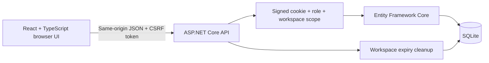

# Architecture and decisions

## A request is a state machine

`Pending → Approved`, `Pending → Rejected`, or `Pending → Cancelled`. A decided or withdrawn request cannot be decided again. This is enforced by the server, not by disabled controls.

Every request has an integer concurrency token. A decision includes the version the reviewer saw. The API checks both pending status and version, and EF Core also treats the version as a concurrency token. A concurrent update produces HTTP 409. The status change and audit event use one EF `SaveChanges` transaction, so an unsuccessful decision cannot leave a false audit record.

## Authorization has three dimensions

1. **Authentication:** ASP.NET Core validates a protected sign-in cookie.
2. **Workspace:** all database operations derive workspace ownership from validated claims, never from caller-supplied ownership fields.
3. **Role and relationship:** requesters see their own requests; approvers and auditors see their current workspace. Approvers cannot decide their own requests. Auditors cannot mutate requests.

Resource IDs are checked against a fictional server-side catalog. New request ownership and initial status are assigned by the server. Guessing a GUID or switching to another demo persona does not cross into another workspace.

## Why a demo workspace instead of shared credentials?

Shared demo accounts make visitors overwrite one another's work. Here, each new session starts a separate persisted dataset. The persona switch only changes identity within that dataset, letting a reviewer test both the permitted and rejected paths. No password or real tenant is required.

The frontend refreshes the antiforgery token after identity changes. Sessions use HTTP-only, SameSite cookies; the production cookie names use the `__Host-` prefix. The public demo runs on its own hostname, separate from the portfolio invitation manager.

## Why SQLite?

The project is a compact, single-instance demonstration. SQLite removes the database setup step while still exercising real migrations, relational persistence, indexes, atomic updates, and concurrent HTTP requests. Multi-instance deployment or sustained write contention would justify a different database and corresponding provider-specific tests.

## Frontend tradeoffs

The app deliberately uses a single-page workspace without a routing dependency. It handles loading, filtered-empty, validation, expired-session, and conflict states. Native `<dialog>` supplies focus containment and escape-key handling. No HTML supplied by visitors is rendered with `dangerouslySetInnerHTML`.

## Extension points

- Replace demo sessions with an OpenID Connect provider such as Microsoft Entra ID.
- Resolve membership from an organization-owned directory and remove demo switching.
- Add a background provisioning worker, with its own restricted credentials, after approval.
- Export audit records to separately controlled storage if stronger evidence retention is required.

These are architectural extension points, not implemented integrations.
